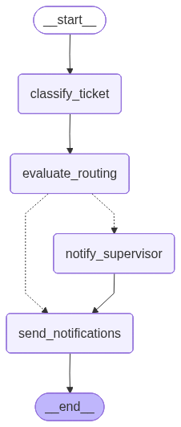

# AI Email Ticketing System

An AI-powered email ticketing system built with LangGraph. Incoming support emails are automatically classified and routed to the right team IT, Support, Helpdesk, or HR with a self-evaluation step and human-in-the-loop oversight before any notification fires.



## How it works

1. **Classifier**: an LLM assigns the email to a team with a confidence score
2. **Evaluator**: a second LLM call independently verifies the routing (`correct` / `uncertain` / `incorrect`)
3. **Conditional routing**: if confidence < 0.8 or the evaluator flags a problem, the graph pauses via `interrupt()` and emails the supervisor
4. **Human-in-the-loop**: the supervisor reviews the flagged ticket on the dashboard and approves or overrides
5. **Notifications**: once confirmed, team members are notified by email and the ticket appears in real time on the dashboard via SSE

## Tech stack

| Layer | Technology |
|---|---|
| Agent orchestration | LangGraph (Python) |
| LLM | Claude Sonnet (Anthropic) / GPT-4o-mini (OpenAI fallback) |
| Email ingestion | Gmail API (OAuth2, optional) |
| Backend API | FastAPI + SQLite |
| Real-time push | Server-Sent Events (SSE) |
| Frontend | Next.js (App Router) + Tailwind CSS |
| Testing | pytest, Jest, Playwright (e2e) |

## Quick start

### Backend

```bash
cd backend
python -m venv .venv && .venv\Scripts\activate   # Windows
pip install -r requirements.txt
cp .env.example .env                              # fill in at least one LLM key
uvicorn app.main:app --reload --port 8000
```

### Frontend

```bash
cd frontend
npm install
cp .env.local.example .env.local
npm run dev   # http://localhost:3000
```

### Tests

```bash
cd backend && pytest tests/ -v --cov=app
cd frontend && npm test
cd e2e && npx playwright test
```

See [`docs/spec.md`](docs/spec.md) for full environment variable reference, Gmail OAuth setup, and email backend options (`log` / Mailtrap / Gmail SMTP).

## Project structure

```
ticketing-ai/
├── backend/
│   └── app/
│       ├── agent/          # LangGraph graph, nodes, state, prompts
│       ├── gmail/          # Gmail API client + polling loop
│       ├── notifications/  # SMTP email sender + SSE broadcaster
│       ├── db/             # SQLAlchemy models + session
│       └── routers/        # tickets, supervisor, stream endpoints
├── frontend/
│   ├── app/                # Dashboard, ticket detail, supervisor queue
│   ├── components/         # TicketCard, TeamBadge, SupervisorModal
│   └── lib/                # API client + SSE hook
├── e2e/                    # Playwright end-to-end tests
└── docs/                   # spec, plan, phase summaries
```

## Roadmap

### Done
- [x] Gmail inbox polling (OAuth2, optional)
- [x] LangGraph classifier + evaluator nodes
- [x] Human-in-the-loop supervisor flow (`interrupt()`)
- [x] FastAPI backend with SSE real-time push
- [x] Next.js dashboard (ticket list, detail, supervisor queue)
- [x] Pluggable email backends: `log` / Mailtrap / Gmail SMTP
- [x] pytest backend suite + Jest frontend tests + Playwright e2e

### Upcoming
- [ ] **Department authentication** — team members log in and see only their team's tickets (`feature/department-auth`)
- [ ] Per-team supervisor roles instead of a single global supervisor
- [ ] Gmail Push Notifications (Pub/Sub) to replace polling
- [ ] Admin UI for managing team member registry (currently `config.yaml`)
- [ ] Ticket assignment within a team (owner field)
- [ ] Metrics dashboard: routing accuracy, avg resolution time
